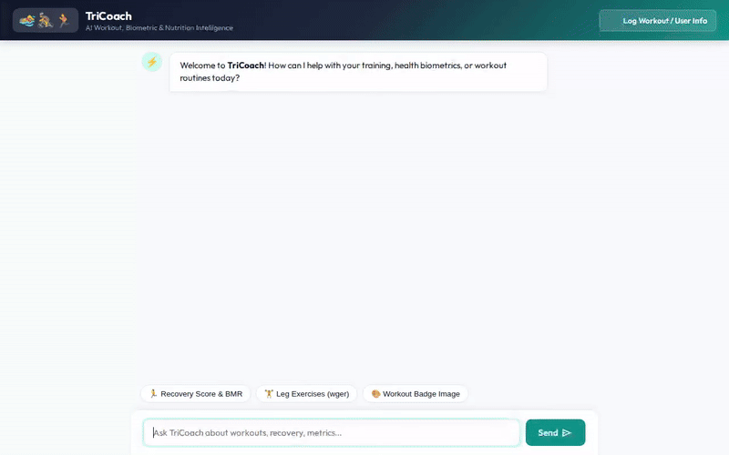

# ⚡ TriCoach — AI-Powered Triathlon & Fitness Coach



**TriCoach** is an intelligent, agentic AI fitness coach built on the **Google Agent Development Kit (ADK)** and powered by **Gemini 2.5 Flash**. Designed for endurance athletes, triathletes, and fitness enthusiasts, TriCoach tracks workouts, calculates vital biometrics, remembers user goals across sessions, generates custom motivational achievement badges, and creates cinematic workout video clips.

---

## 🌟 Key Features & Capabilities

### 🧠 Cross-Session Durable Memory (Vertex AI Memory Bank)
- Automatically extracts and stores user preferences, health goals, and historical fitness stats across sessions.
- Pre-loads user context at the start of each conversation using `PreloadMemoryTool` wired to Vertex AI Memory Bank.

### 📊 Workout & Biometric Logging (Cloud Firestore)
- **Exercise Catalog**: Search for targeted strength, cardio, and endurance exercises in Firestore (`search_exercise_catalog`).
- **Activity Tracker**: Log athlete workouts, duration, calories burned, heart rate, and personal notes (`log_activity`).
- **Workout History**: Retrieve recent logs and activity history per athlete (`get_recent_logs`).

### 🧮 Advanced Fitness Metrics & BMR Calculator
- Calculates Basal Metabolic Rate (BMR) via Mifflins-St Jeor formula.
- Computes Total Daily Energy Expenditure (TDEE), daily hydration targets, target heart rate zones (Karvonen formula), and recovery scores based on sleep and SpO2 (`calculate_fitness_metrics`).

### 🎨 3D Achievement Badge Generation (Google Imagen 3)
- Generates vibrant, 3D motivational milestone badges for step achievements and workout streaks using **Imagen 3 (`imagen-3.0-generate-002`)**.
- Uploads badge assets directly to Google Cloud Storage and returns public HTTPS URLs (`generate_motivation_badge`).

### 🎬 Cinematic Workout Video Generation (Google Omni)
- Generates 5-second cinematic video clips of athletic scenes using **Gemini Omni (`gemini-omni-flash-preview`)** via Vertex AI Interactions API.
- Saves video artifacts directly to the ADK Playground Artifacts panel and uploads video files to Google Cloud Storage (`generate_workout_video`).

### 🌐 Live Exercise Discovery (wger REST API)
- Queries the external `wger` Workout Manager REST API for live exercise ideas, target muscles, and equipment requirements (`fetch_external_exercises`).

### 📱 Responsive A2UI Cards (v0.8)
- Emits structured A2UI UI card representations (`Card`, `Column`, `Row`, `Text`, `Image`) rendered directly in the custom web frontend.

---

## 🏗️ Architecture & Cloud Infrastructure

| Component | Technology | Purpose |
| --- | --- | --- |
| **Agent Core** | Google ADK + Gemini 2.5 Flash | Reasoning engine & tool orchestration |
| **Durable Memory** | Vertex AI Memory Bank | Cross-session memory persistence |
| **Database** | Google Cloud Firestore | Structured storage for exercises & workout logs |
| **Media Bucket** | Google Cloud Storage | Hosting public badge images & generated videos |
| **Image Model** | Imagen 3 (`imagen-3.0-generate-002`) | Custom 3D motivational badge generation |
| **Video Model** | Gemini Omni (`gemini-omni-flash-preview`) | Text-to-video athletic clip generation |
| **Frontend Proxy** | FastAPI + Uvicorn | A2A protocol proxy & web frontend server |
| **UI Rendering** | A2UI (v0.8 Schema) | Native rendering of structured UI cards |

---

## 🚧 Planned Features (Not Yet Implemented)

- **Real-Time Bluetooth Wearable Sync**: Direct integration with Garmin / Apple Watch BLE GATT services (planned for future release).
- **Automated Meal Plan Generation**: AI macro-nutrient meal planner tied to daily TDEE targets (planned for future release).

---

## 🚀 Local Setup & Running Instructions

### Prerequisites
- Python 3.11+
- `uv` package manager (`pip install uv`)
- Google Cloud SDK (`gcloud auth application-default login`)

### 1. Install Dependencies
```bash
uv sync
```

### 2. Run Agent Playground (ADK Web)
To launch the interactive ADK agent playground locally:
```bash
uv run adk web . --port 8080 --reload_agents
```

### 3. Run Custom Web Frontend Proxy
To run the lightweight FastAPI proxy and custom TriCoach chat interface:
```bash
cd frontend
pip install -r requirements.txt
python main.py
```

---

## 📦 Deployment Instructions

### Deploy Agent Engine to Vertex AI
Deploy the agent runtime to Google Cloud Agent Platform:
```bash
uv run agents-cli deploy --project <YOUR_GCP_PROJECT_ID>
```

### Deploy Web Frontend to Cloud Run
Build and deploy the web interface to Google Cloud Run:
```bash
cd frontend
gcloud run deploy tricoach-frontend \
  --source . \
  --region us-central1 \
  --allow-unauthenticated \
  --set-env-vars AGENT_ENGINE_RESOURCE_NAME="<YOUR_AGENT_RESOURCE_NAME>",AGENT_DIRECTORY="app"
```
